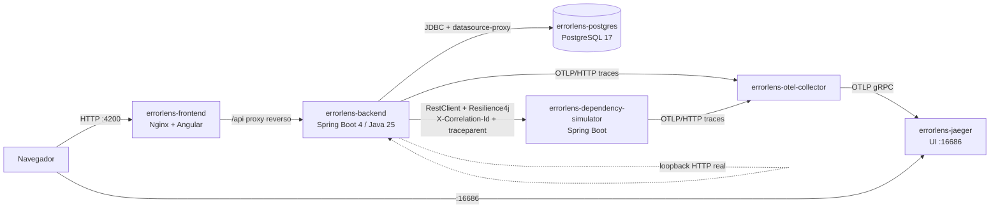

# ErrorLens

> **Execute. Trace. Investigate. Understand.**

ErrorLens é um laboratório local de **diagnóstico, rastreabilidade e simulação de falhas** em aplicações
Java/Spring Boot. Ele executa cenários reais de sucesso e de falha contra um backend de verdade
(Spring Security, controllers, services, JPA, PostgreSQL e uma dependência externa simulada), registra
cada etapa com instrumentação real, correlaciona logs e traces e produz diagnósticos com um motor de
regras local — sem IA, sem serviços pagos e sem credenciais externas.

---

## Sumário

1. [Visão geral](#visão-geral)
2. [Arquitetura](#arquitetura)
3. [Tecnologias](#tecnologias)
4. [Estrutura de pastas](#estrutura-de-pastas)
5. [Requisitos](#requisitos)
6. [Execução com Docker Compose](#execução-com-docker-compose)
7. [Execução local para desenvolvimento](#execução-local-para-desenvolvimento)
8. [Endereços dos serviços](#endereços-dos-serviços)
9. [Credenciais demonstrativas](#credenciais-demonstrativas)
10. [Catálogo de cenários](#catálogo-de-cenários)
11. [Telas](#telas)
12. [API REST](#api-rest)
13. [Como executar os testes](#como-executar-os-testes)
14. [Como consultar traces no Jaeger](#como-consultar-traces-no-jaeger)
15. [Como investigar erros](#como-investigar-erros)
16. [Como adicionar cenários](#como-adicionar-cenários)
17. [Como adicionar regras ao Diagnosis Engine](#como-adicionar-regras-ao-diagnosis-engine)
18. [Segurança: laboratório × produção](#segurança-laboratório--produção)
19. [Problemas comuns](#problemas-comuns)
20. [Decisões técnicas](#decisões-técnicas)

---

## Visão geral

| Recurso | O que faz |
|---|---|
| **Dashboard** | Totais, taxa de erro, tempo médio/p95, evolução temporal, distribuição por status HTTP, exceptions e cenários mais frequentes, duração das requisições e saúde dos serviços — tudo calculado no PostgreSQL. |
| **Scenario Lab** | 25 cenários reproduzíveis (A–F) com filtros por categoria, execução real, variantes de sucesso/falha e **Compare Modes**. |
| **Investigation Center** | Overview, Request, Response, Exception, Stack Trace, Timeline, Logs e Diagnosis de uma execução; cópia de informações técnicas e exportação JSON/Markdown/PDF. |
| **Execution Timeline** | Fluxo canônico (Angular → Runner → HTTP → Security → Controller → Service → Repository → PostgreSQL → Chamada externa → Resilience4j → Exception Handler → Response → Verificação) com eventos e durações **medidos**. Camadas sem eventos aparecem como "não registrada"; a origem Angular é marcada "sem instrumentação". |
| **Execution Comparator** | Alinha os fluxos das duas execuções (LCS), aponta a **primeira divergência observável**, mostra diffs de campos, corpos, headers, exceptions e logs — sem afirmar causalidade. |
| **Stack Trace Analyzer** | Interpreta `Caused by`, `Suppressed`, `... N more`, mensagens multilinha e conteúdo truncado; classifica frames (aplicação, Spring, Hibernate, JDK, Tomcat, driver JDBC…). |
| **HTTP Error Analyzer** | Interpreta Problem Details (RFC 9457), erro padrão do Spring Boot e JSON comuns com regras determinísticas por status/headers. |
| **Log Analyzer** | Importa `.log`, `.txt` e `.json` (até 2 MB, UTF-8 validado), agrupa por correlationId, filtra por nível/período/texto e exibe a linha do tempo. |
| **Histórico** | Execuções persistidas com filtros (período, resultado, status, cenário, correlationId, exception, busca livre), ordenação, paginação, comparação, exclusão e retenção. |
| **Relatórios** | Exportação sanitizada em JSON, Markdown e PDF. |
| **Guided Tour** | Demonstração guiada de 7 passos usando funcionalidades reais (executar A02 e D01, diagnóstico, causa provável, logs, comparação, rastreabilidade). |

## Arquitetura



**Como uma execução funciona** (`POST /api/v1/scenarios/{código}/execute`):

1. O **Scenario Runner** registra um trace em memória, prepara dados isolados (ex.: cliente descartável)
   e, se preciso, configura o dependency-simulator com uma chave exclusiva da execução.
2. Envia uma **requisição HTTP real** ao próprio backend (`/api/v1/lab/**`) com `X-Correlation-Id`,
   o header da execução e credenciais HTTP Basic de laboratório.
3. Essa requisição atravessa Tomcat → Spring Security → controller → service → repositório → PostgreSQL
   (ou a dependência externa). Filtros, aspecto AOP, listener JDBC (datasource-proxy), eventos do
   Resilience4j e o `@RestControllerAdvice` registram etapas **com tempos medidos**; um appender do
   Logback captura os logs com o MDC da execução.
4. O runner recebe a resposta, executa verificações automáticas (ex.: rollback do D04), executa o
   **Diagnosis Engine** e persiste tudo (dados sanitizados) no PostgreSQL.

O backend segue camadas simples: `domain` (entidades e exceptions), `application` (casos de uso,
cenários, diagnóstico, analisadores, relatórios), `infrastructure` (persistência, observabilidade,
segurança, cliente do simulador, resiliência) e `interfaces` (REST da plataforma, API de laboratório,
tratamento de erros). Detalhes em [docs/architecture.md](docs/architecture.md).

## Tecnologias

| Camada | Tecnologias (versões efetivamente usadas) |
|---|---|
| Frontend | Angular 22.2 (standalone, Signals, `@if/@for/@switch`, zoneless, lazy loading), TypeScript 6, RxJS 7.8, Reactive Forms, SCSS, ECharts 6 (import modular), Monaco Editor 0.57 (build AMD servido localmente), Lucide 1.66, Vitest 5, Playwright 1.64 |
| Backend | Java 25, Spring Boot 4.1.2 (Web MVC, Validation, Data JPA, Security, Actuator, AspectJ/AOP, RestClient), Hibernate 7, Jackson 3, Flyway, PostgreSQL JDBC, Resilience4j 2.4 (`spring-boot4`), Micrometer Tracing + OpenTelemetry (OTLP), Logback com logs estruturados (Logstash JSON), datasource-proxy 1.11, springdoc-openapi 3.2, OpenPDF 3.0 |
| Testes backend | JUnit 5, Mockito, AssertJ, Spring Boot Test, Testcontainers 2.0 (PostgreSQL) |
| Infraestrutura | Docker, Docker Compose, PostgreSQL 17, Nginx 1.29, OpenTelemetry Collector Contrib 0.140, Jaeger 2.12 |

## Estrutura de pastas

```text
errorlens/
├── frontend/                 Angular (src/app/core, layout, shared, features) + e2e Playwright
├── backend/                  Spring Boot (dev.errorlens.{domain,application,infrastructure,interfaces})
│   └── src/main/resources/
│       ├── db/migration/     Flyway: esquema, dados demonstrativos e catálogo de cenários
│       └── diagnosis/        rules.json (regras declarativas do Diagnosis Engine)
├── dependency-simulator/     Spring Boot que simula dependências externas
├── infrastructure/
│   ├── nginx/                default.conf (SPA + proxy reverso /api)
│   ├── otel/                 otel-collector.yaml
│   ├── postgres/init/        ajustes do banco na primeira inicialização
│   └── certs/                CAs extras opcionais para builds atrás de proxy TLS
├── docs/                     arquitetura e guias
├── examples/                 stacktraces/, http-errors/, logs/ (carregáveis pela interface)
├── docker-compose.yml
├── .env.example
└── README.md
```

## Requisitos

- **Para executar:** apenas Docker e Docker Compose (v2+). Nenhuma outra ferramenta no host.
- **Para desenvolver:** JDK 25, Node.js 24 (npm 11) e Docker (para PostgreSQL e Testcontainers).
  O Maven é fornecido pelo Maven Wrapper (`./mvnw`).

## Execução com Docker Compose

```bash
cp .env.example .env          # opcional: ajuste portas e senhas de laboratório
docker compose up --build -d  # constrói e inicia todos os serviços
docker compose ps             # acompanhe os healthchecks
```

Na primeira inicialização o Flyway cria o esquema, os 12 clientes/8 pedidos demonstrativos e o catálogo de
25 cenários. Abra <http://localhost:4200> e entre com `admin` / `errorlens`.

Para encerrar:

```bash
docker compose down
```

Para encerrar **e apagar os dados persistidos** (volume do PostgreSQL: histórico, execuções e dados do
laboratório):

```bash
docker compose down -v
```

> ⚠️ `docker compose down -v` remove o volume `errorlens-pgdata`. Na próxima subida o banco é recriado
> do zero pelas migrations.

## Execução local para desenvolvimento

```bash
# 1) PostgreSQL
docker run -d --name errorlens-dev-pg -p 5432:5432 \
  -e POSTGRES_DB=errorlens -e POSTGRES_USER=errorlens -e POSTGRES_PASSWORD=errorlens-lab-db postgres:17-alpine

# 2) Dependency simulator (porta 8090)
cd dependency-simulator && ./mvnw spring-boot:run

# 3) Backend (porta 8080) - LOG_FORMAT vazio = logs em texto no console
cd backend && LOG_FORMAT= ./mvnw spring-boot:run

# 4) Frontend (porta 4200, proxy /api -> localhost:8080 via proxy.conf.json)
cd frontend && npm ci && npm start
```

Sem o Collector/Jaeger locais o backend continua funcionando (apenas registra falha ao exportar spans).
Para subir só a observabilidade: `docker compose up -d errorlens-otel-collector errorlens-jaeger`
e use `OTEL_EXPORTER_OTLP_TRACES_ENDPOINT=http://localhost:4318/v1/traces` (publique a porta 4318 do
collector se necessário).

## Endereços dos serviços

| Serviço | URL | Observação |
|---|---|---|
| Frontend | <http://localhost:4200> | Nginx; `/api` é encaminhado ao backend (sem CORS) |
| Backend API | <http://localhost:8080> | Publicado para testes locais (curl/Swagger). Pode ser removido do Compose: o frontend usa o proxy |
| Swagger UI | <http://localhost:8080/swagger-ui.html> (ou via frontend: <http://localhost:4200/swagger-ui.html>) | OpenAPI em `/v3/api-docs` |
| Jaeger UI | <http://localhost:16686> | Traces distribuídos (backend + simulador) |
| PostgreSQL, simulador, collector | — | Somente rede interna `errorlens-network` (portas não publicadas) |

## Credenciais demonstrativas

Identidades **locais de laboratório** (Spring Security, `InMemoryUserDetailsManager`, senhas com BCrypt).
São configuráveis por variáveis de ambiente (`.env`). **Não são credenciais de produção.**

| Usuário | Senha padrão | Roles | Uso |
|---|---|---|---|
| `admin` | `errorlens` | ADMIN, ANALYST, OPERATOR, AUDITOR | Acesso completo, exclusão de histórico e reset do laboratório |
| `analyst` | `analyst-lab` | ANALYST | Executa cenários, investiga, usa analisadores |
| `viewer` | `viewer-lab` | VIEWER | Somente dashboard e catálogo (usado no cenário C02) |
| `auditor` | `auditor-lab` | AUDITOR | Acessa o relatório protegido (cenário C03) |
| `runner` | `runner-lab` | OPERATOR | Identidade técnica do Scenario Runner para `/api/v1/lab/**` |

O frontend autentica em `POST /api/v1/auth/login` e recebe um **token opaco** (apenas o hash SHA-256 fica
no servidor; expira em 8h). Os cenários usam **HTTP Basic real** contra o Spring Security.

## Catálogo de cenários

| Código | Cenário | Esperado | Compare Modes |
|---|---|---|---|
| A01 | Consulta válida | 200 | ✔ (existente × inexistente) |
| A02 | Criação válida | 201 | ✔ (e-mail único × duplicado) |
| A03 | Atualização válida | 200 | — |
| A04 | Exclusão válida (cliente descartável) | 204 | ✔ (sem pedidos × com pedidos) |
| A05 | Consulta paginada | 200 | — |
| B01 | Cliente inexistente — `ResourceNotFoundException` | 404 | ✔ |
| B02 | DTO inválido — `MethodArgumentNotValidException` | 400 | ✔ |
| B03 | JSON malformado — `HttpMessageNotReadableException` | 400 | ✔ |
| B04 | Parâmetro inválido — `MethodArgumentTypeMismatchException` | 400 | — |
| B05 | Método não permitido (PATCH) | 405 | — |
| C01 | Sem autenticação | 401 | ✔ |
| C02 | Sem permissão (viewer) | 403 | ✔ |
| C03 | Acesso autorizado (auditor) | 200 | ✔ |
| D01 | Registro duplicado — unique `uk_customers_email` (SQLState 23505) | 409 | ✔ |
| D02 | Violação de chave estrangeira — `fk_orders_customer` (23503) | 409 | ✔ |
| D03 | Falha de persistência — tabela inexistente (`BadSqlGrammarException`, 42P01) | 500 | — |
| D04 | Rollback transacional com **verificação automática no banco** | 500 | ✔ (commit × rollback) |
| E01 | `NullPointerException` (Helpful NPE) | 500 | ✔ |
| E02 | `IllegalArgumentException` | 400 | ✔ |
| E03 | Exception encadeada (`Caused by` → `NumberFormatException`) | 422 | ✔ |
| F01 | Timeout — Resilience4j TimeLimiter (1,5 s × dependência de 3,5 s) | 504 | ✔ |
| F02 | Retry com recuperação (falha 2×, sucesso na 3ª) | 200 | — |
| F03 | Retry esgotado (4 tentativas) | 502 | ✔ |
| F04 | Circuit Breaker — CLOSED → OPEN → HALF_OPEN → OPEN (`CallNotPermittedException`) | 503 | ✔ (recupera para CLOSED) |
| F05 | Fallback — resposta **DEGRADADA** (HTTP 200 + `X-ErrorLens-Degraded`) | 200 | ✔ |

Isolamento e reprodutibilidade: e-mails únicos por execução, clientes descartáveis (`origin = SCENARIO`)
removidos automaticamente após 1h, chave de simulação exclusiva por execução no dependency-simulator,
reset dos circuit breakers na preparação de F04/F05 e execução exclusiva dos cenários com estado
compartilhado. Concorrência total limitada (`errorlens.runner.max-concurrent-executions`, padrão 4).

## Telas

Dashboard, Scenario Lab, Investigation Center (com Timeline), Execution Comparator, Stack Trace Analyzer,
HTTP Error Analyzer, Log Analyzer, Histórico, Relatórios, Guided Tour e Configurações. Tema escuro padrão
com alternância para claro (preferência salva no navegador), layout responsivo, estados de carregamento,
vazio e erro, toasts e busca global (`Ctrl+K`: aceita `#id`, correlationId, código de cenário ou exception).

## API REST

Todos os endpoints estão documentados no Swagger UI. Principais:

```text
POST   /api/v1/auth/login                      token de sessão (identidades locais)
GET    /api/v1/scenarios                       catálogo com estatísticas de uso
GET    /api/v1/scenarios/{id}
POST   /api/v1/scenarios/{id}/execute          { "mode": "DEFAULT|SUCCESS|FAILURE" }
POST   /api/v1/scenarios/{id}/compare-modes    executa sucesso + falha e compara

GET    /api/v1/executions                      histórico (from, to, outcome, httpStatus, scenario,
                                               correlationId, exception, q, page, size, sort, direction)
GET    /api/v1/executions/{id}
GET    /api/v1/executions/by-correlation/{correlationId}
GET    /api/v1/executions/{id}/logs
GET    /api/v1/executions/{id}/timeline
GET    /api/v1/executions/{id}/report?format=json|markdown|pdf
POST   /api/v1/executions/compare              { "leftId": 1, "rightId": 2 }
DELETE /api/v1/executions/{id}                 (ADMIN)
DELETE /api/v1/executions?olderThanDays=N      retenção (ADMIN)

POST   /api/v1/analyzer/stacktrace             { "content": "...", "applicationPackages": ["com.acme"] }
POST   /api/v1/analyzer/http-error             { method, url, status, headers, body }
POST   /api/v1/analyzer/logs                   multipart (file)
POST   /api/v1/analyzer/logs/text              { "content": "..." }
GET    /api/v1/analyzer/examples[/{id}]        exemplos prontos
GET    /api/v1/analyzer/rules                  regras ativas do Diagnosis Engine

GET    /api/v1/dashboard/summary?range=1h|24h|7d|30d
GET    /api/v1/dashboard/metrics?range=...
GET    /api/v1/health/services
POST   /api/v1/lab-admin/reset                 (ADMIN, perfil lab)

/api/v1/lab/**                                 API real de laboratório exercitada pelos cenários
```

Erros seguem **Problem Details (RFC 9457)** com extensões `errorCode`, `correlationId` e `timestamp`.
Stack traces, SQL e mensagens internas nunca aparecem nas respostas públicas — apenas nos endpoints de
diagnóstico autorizados (ANALYST/ADMIN), já sanitizados.

## Como executar os testes

```bash
# Backend: unitários + integração (Testcontainers sobe PostgreSQL; requer Docker)
cd backend && ./mvnw test

# Dependency simulator
cd dependency-simulator && ./mvnw test

# Frontend: unitários (Vitest)
cd frontend && npm test

# E2E (Playwright) contra a aplicação em execução (Docker Compose ou ng serve + backend)
cd frontend && npx playwright install chromium && npm run e2e
# outra URL: E2E_BASE_URL=http://localhost:4200 npm run e2e
```

Os testes E2E executam cenários reais e verificam os resultados (status HTTP, diagnóstico com SQLState 23505,
etapas da timeline como `PostgreSQL · INSERT customers` e `ROLLBACK`, primeira divergência da comparação,
filtragem do histórico por correlationId e restrição de permissões).

## Como consultar traces no Jaeger

1. Execute um cenário (ex.: D01) e abra a investigação.
2. Clique no ícone ao lado do **TraceId** (ou "Trace distribuído no Jaeger" na aba Timeline). O link abre
   `http://localhost:16686/trace/{traceId}`.
3. No Jaeger, o trace contém o span da chamada `POST /api/v1/scenarios/{id}/execute`, o span cliente do
   RestClient, o span servidor da requisição de laboratório, as consultas e — nos cenários F — os spans do
   `errorlens-dependency-simulator` (contexto W3C `traceparent` propagado).
4. Também é possível buscar por serviço (`errorlens-backend`, `errorlens-dependency-simulator`).

## Como investigar erros

1. **Encontre a execução:** busca global (correlationId, `#id`, exception) ou Histórico com filtros.
2. **Overview:** status obtido × esperado, errorCode, exception, root cause, componentes envolvidos e
   verificação automática.
3. **Exception / Stack Trace:** cadeia de causas e root cause; envie o stack trace ao Stack Trace Analyzer
   para destacar os frames da aplicação.
4. **Timeline:** onde a falha surgiu (ex.: `PostgreSQL · INSERT customers` com SQLState 23505) e como se
   propagou (Repository → Service → Controller → Exception Handler).
5. **Logs:** logs correlacionados pelo MDC da execução.
6. **Diagnosis:** hipóteses ordenadas por pontuação de evidências, com causas possíveis, sugestões,
   correções e exemplos. São hipóteses, não causas comprovadas.
7. **Compare:** compare com uma execução bem-sucedida para ver a primeira divergência observável.

## Como adicionar cenários

1. Inclua a linha descritiva em uma nova migration Flyway (ex.: `V4__novo_cenario.sql`) na tabela
   `scenarios` (código, nome, categoria, endpoint, status esperado, explicação, tags, variantes).
2. Implemente o comportamento em um bean `ScenarioHandlerGroup`
   (`backend/src/main/java/dev/errorlens/application/scenario/handlers`):

```java
ScenarioHandler.of("G01", (mode, support) -> ScenarioPlan
        .request("GET", "/api/v1/lab/customers/" + support.seedCustomerId(ScenarioSupport.SEED_ANA))
        .as(LabIdentities.RUNNER)
        .expect(mode == ExecutionMode.FAILURE ? 404 : 200)
        .variant("Descrição da variante")
        .build());
```

3. Se o cenário precisar de um novo endpoint, crie-o em `interfaces/lab` (com o serviço em `application/lab`
   — eles são instrumentados automaticamente pelo aspecto).
4. Na inicialização, o `ScenarioRegistry` registra no log qualquer inconsistência entre catálogo e handlers.

## Como adicionar regras ao Diagnosis Engine

**Declarativa** — acrescente um objeto em `backend/src/main/resources/diagnosis/rules.json`:

```json
{
  "id": "MINHA_REGRA",
  "title": "Título exibido",
  "category": "BANCO_DE_DADOS",
  "description": "O que o padrão significa.",
  "match": {
    "exceptions": ["MinhaException", "com.acme.OutraException"],
    "messagePatterns": ["regex na mensagem"],
    "httpStatuses": [409],
    "errorCodes": ["MEU_CODIGO"],
    "sqlStates": ["23505"],
    "allowWithoutException": false,
    "requireMessageMatch": false
  },
  "possibleCauses": ["..."],
  "suggestions": ["..."],
  "fixes": ["..."],
  "codeExample": "..."
}
```

Pontuação: exception na root cause 50, exception principal 40, intermediária 30, SQLState 20, padrão de
mensagem 15, status 15, errorCode 15 (máximo 95). Confiança: ALTA ≥ 70, MÉDIA ≥ 45, BAIXA abaixo disso.

**Programática** — crie um bean que implemente `DiagnosisRule` (veja `ResilienceRules`, que analisa
sequências de tentativas, transições de circuito, fallback e rollback).

## Segurança: laboratório × produção

O ErrorLens **provoca falhas de propósito** e é destinado a uso **local**.

- O projeto inicia no perfil `lab`. No perfil `prod` (`SPRING_PROFILES_ACTIVE=prod`) os endpoints de
  laboratório/simulação (`/api/v1/lab/**`, `/api/v1/lab-admin/**`) não são registrados e o Swagger é desabilitado;
  os endpoints de controle do simulador só existem no perfil `lab`.
- Cenários destrutivos atuam apenas sobre dados de laboratório (clientes descartáveis); não há SQL
  arbitrário, execução de código enviado pelo usuário nem chamadas a URLs arbitrárias (as URLs do
  simulador/health são fixas na configuração; o HTTP Error Analyzer apenas interpreta a URL informada).
- Endpoints de diagnóstico exigem ROLE_ANALYST/ADMIN; exclusões e reset exigem ADMIN.
- Headers `Authorization`, `Cookie`, tokens e senhas são mascarados; campos sensíveis de JSON (password,
  token, secret, document/CPF…) e valores em detalhes de constraint do PostgreSQL são ocultados antes da
  persistência e novamente na exportação.
- Limites: payload multipart 2 MB, stack trace 512 KB, corpo HTTP analisado 256 KB, 5.000 entradas de log,
  concorrência de cenários, timeouts de dependência, retries e janela do circuit breaker limitados,
  `statement_timeout` de 30 s no banco.
- CORS restrito a `http://localhost:4200` (desenvolvimento); em Docker o acesso é same-origin via Nginx.

**Não publique o ErrorLens na internet** sem autenticação forte (IdP/OIDC), autorização revisada, TLS,
segredos gerenciados, rate limiting e endurecimento adicional.

## Problemas comuns

| Sintoma | Causa provável / solução |
|---|---|
| Build Docker falha com `PKIX path building failed` ou `certificate verify failed` | Proxy corporativo/antivírus inspecionando TLS. Copie o certificado raiz para `infrastructure/certs/*.crt` (veja o README da pasta) e rode `docker compose build --no-cache`. Localmente (Windows), use `MAVEN_OPTS=-Djavax.net.ssl.trustStoreType=Windows-ROOT`. |
| Porta 4200/8080/16686 em uso | Ajuste `FRONTEND_PORT`, `BACKEND_PORT` e `JAEGER_UI_PORT` no `.env`. |
| Frontend mostra "Não foi possível conectar ao backend" | Verifique `docker compose ps` e `docker compose logs errorlens-backend`. O backend aguarda o PostgreSQL e o simulador ficarem saudáveis. |
| Saúde mostra Collector/Jaeger indisponíveis | Em execução local sem Compose isso é esperado; o backend continua funcionando. |
| Cenário F04/F05 retorna 429 `SCENARIO_BUSY` | Outra execução usa o mesmo circuit breaker; aguarde alguns segundos. |
| Sessão expira após reiniciar o backend | Tokens ficam em memória: entre novamente. |
| Quero começar do zero | `docker compose down -v && docker compose up --build -d` (apaga os dados). |

## Decisões técnicas

- **Requisição real em loopback:** em vez de simular resultados, o runner faz uma chamada HTTP real ao
  próprio backend, garantindo que Spring Security, conversores, validação, transações e exception handler
  participem de verdade.
- **Instrumentação sem invenção:** etapas vêm de filtros servlet, aspecto AOP, datasource-proxy (comandos
  SQL com tempo do driver, BEGIN/COMMIT/ROLLBACK), eventos do Resilience4j e do exception handler. Eventos
  pontuais são exibidos como "sem medição".
- **Frontend sem PrimeNG:** a linha atual do PrimeNG compatível com Angular 22 (22.x) passou a exigir uma
  chave de licença PrimeUI e exibe um aviso "Invalid PrimeUI License" sem ela; a linha 21 também é licenciada
  e não suporta Angular 22. Como o projeto não pode depender de credenciais externas, toast, diálogo,
  confirmação e tooltips foram implementados no próprio projeto (`shared/overlays.ts`).
- **Monaco offline:** o build AMD do Monaco é copiado para `/assets/monaco` no build, sem CDN.
- **Testcontainers com container singleton** compartilhado entre classes de teste de integração.
