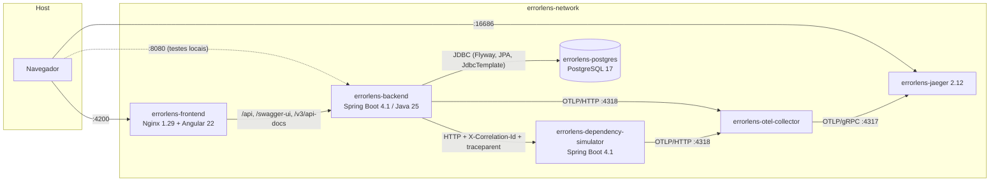
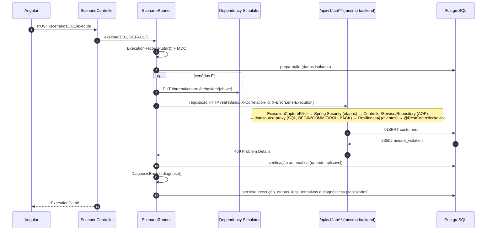
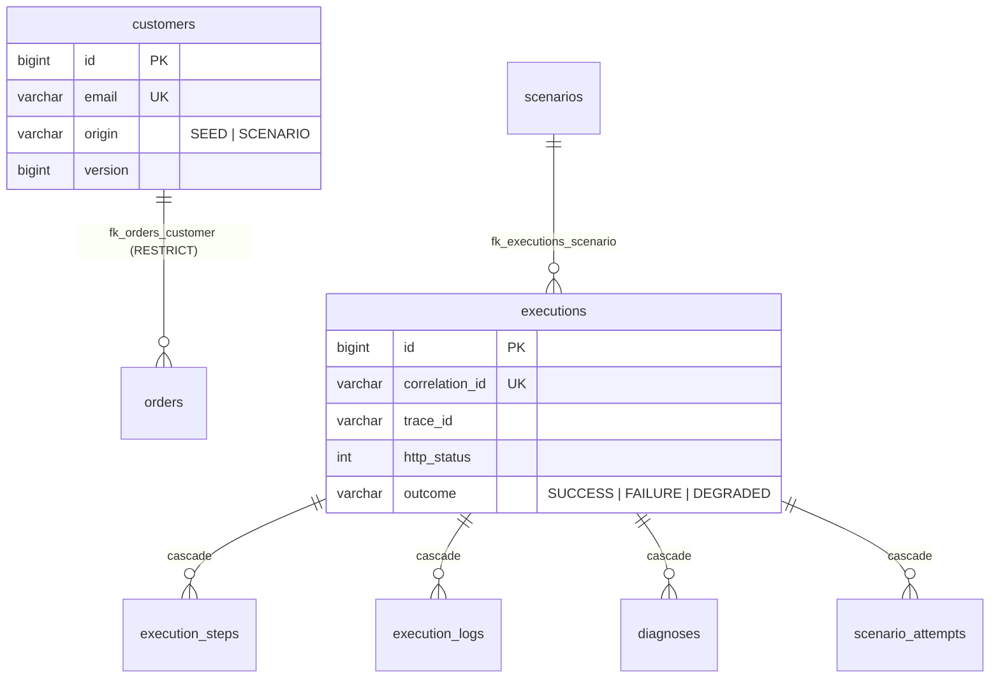

# Arquitetura do ErrorLens

## Visão de containers

## Fluxo de uma execução de cenário

## Camadas do backend

| Pacote | Responsabilidade |
|---|---|
| `domain` | Entidades JPA (`Customer`, `Order`, `Scenario`, `Execution`, `ExecutionStep`, `ExecutionLog`, `DiagnosisRecord`, `ScenarioAttempt`), enums e exceptions de domínio. |
| `application.lab` | Serviços do domínio de laboratório (clientes, pedidos, fidelidade, arquivamento, auditoria, integrações com Resilience4j). |
| `application.scenario` | Catálogo, handlers dos cenários, `ScenarioRunner`, `LabRequestDispatcher` (loopback HTTP). |
| `application.execution` | Persistência, consultas, timeline, comparação (LCS), retenção. |
| `application.diagnosis` | `DiagnosisEngine`, regras declarativas (`rules.json`) e programáticas. |
| `application.analyzer` | Stack trace parser/analyzer, HTTP error analyzer, log analyzer, exemplos. |
| `application.dashboard`, `health`, `report`, `auth` | Indicadores, saúde dos serviços, relatórios (JSON/MD/PDF), tokens. |
| `infrastructure.observability` | CorrelationId, captura de execução, contexto por thread, aspecto AOP, listener JDBC, appender Logback, sanitização, propagação de contexto assíncrono. |
| `infrastructure.security` | Filtros de token e de etapas de segurança, handlers 401/403 em Problem Details, identidades. |
| `infrastructure.simulator`, `resilience`, `persistence` | Clientes HTTP do simulador, eventos Resilience4j, repositórios Spring Data. |
| `interfaces.rest`, `interfaces.lab`, `interfaces.error` | API da plataforma, API de laboratório e tratamento global de exceptions. |

## Modelo de dados

## Propagação de contexto

- **HTTP de entrada:** `CorrelationIdFilter` reutiliza/gera `X-Correlation-Id`, publica no MDC e no header
  de resposta e limpa o MDC ao final.
- **Execução:** `ExecutionCaptureFilter` só instrumenta requisições cujo header de execução corresponde a um
  trace registrado pelo próprio backend (impede injeção externa).
- **Assíncrono:** `ContextPropagatingTaskDecorator` copia MDC, contexto de execução e `ContextSnapshot` do
  Micrometer para as threads do executor usado pelo TimeLimiter e restaura o estado anterior ao final.
- **HTTP de saída:** `OutboundCallInterceptor` envia `X-Correlation-Id`; o RestClient observado envia
  `traceparent` (W3C) — o simulador reutiliza ambos.
